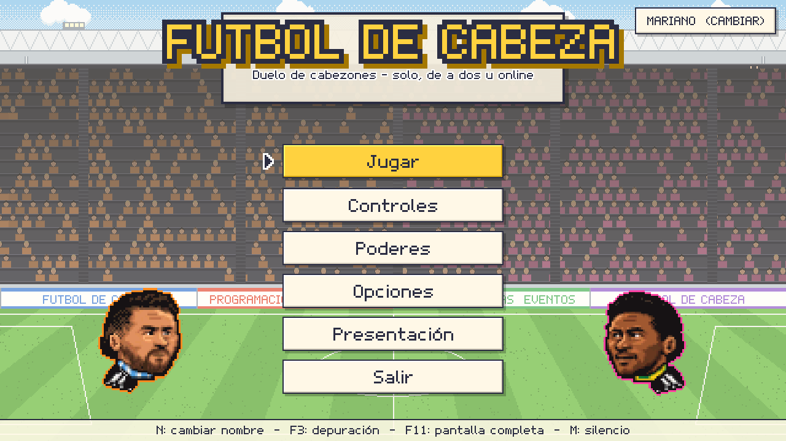
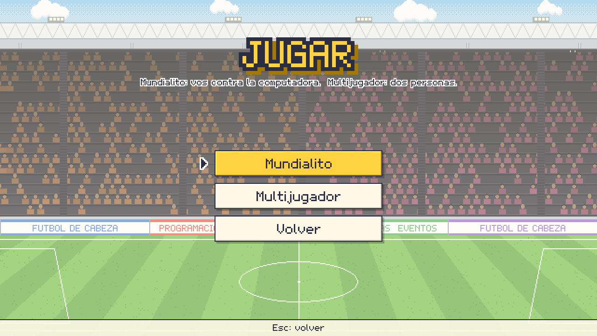
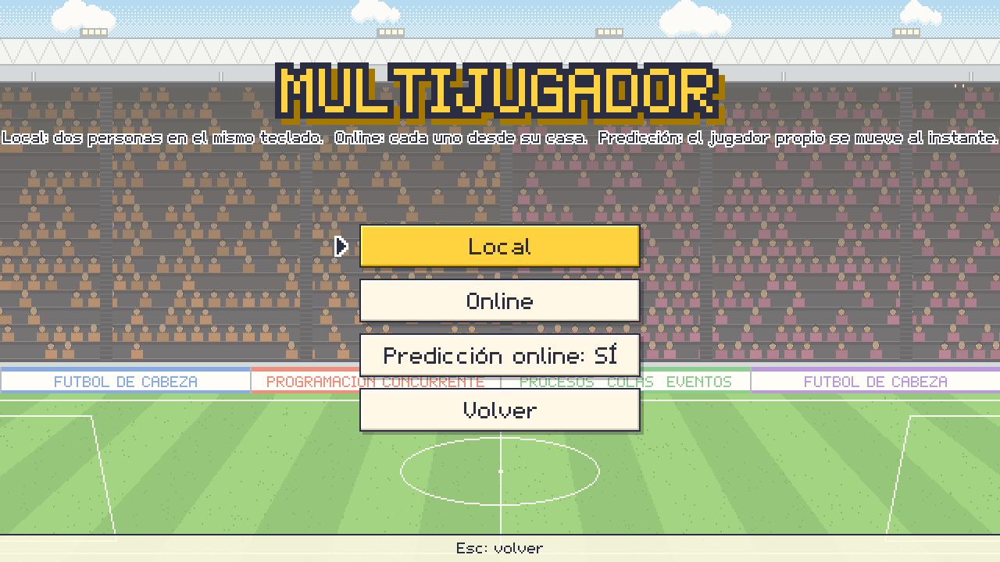
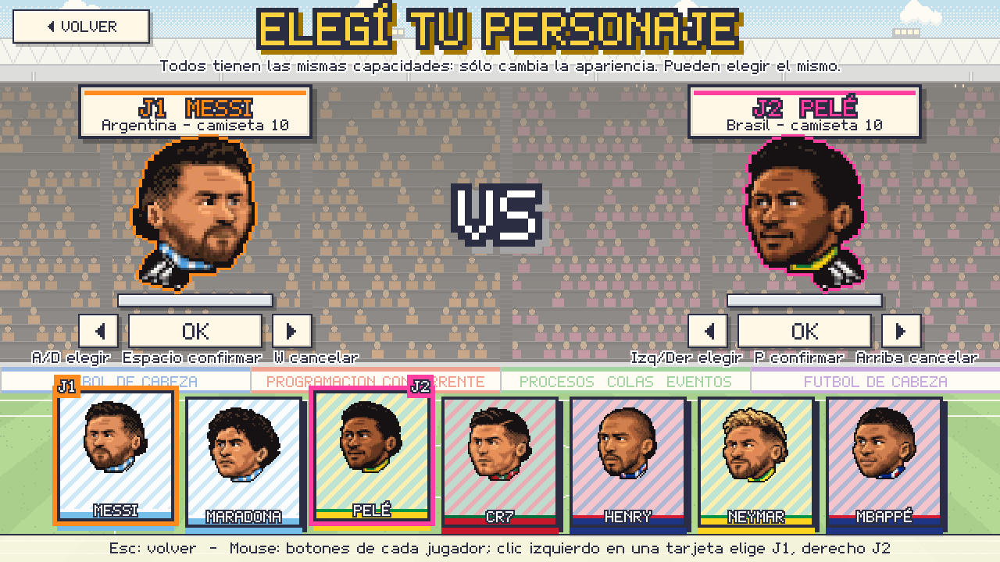
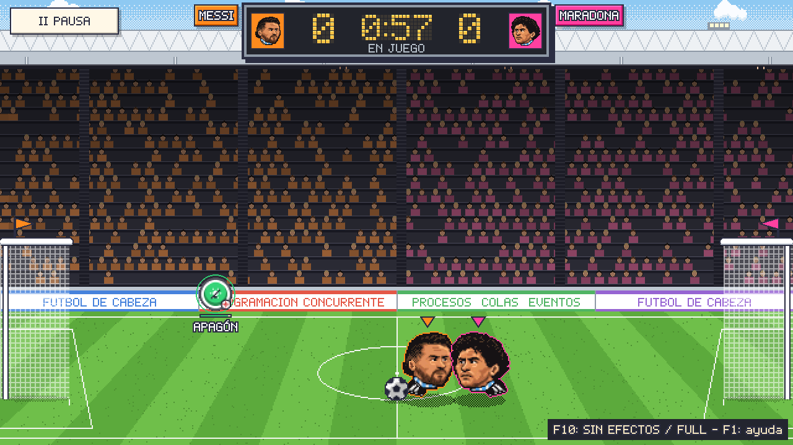
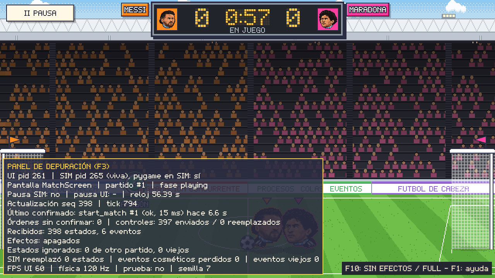
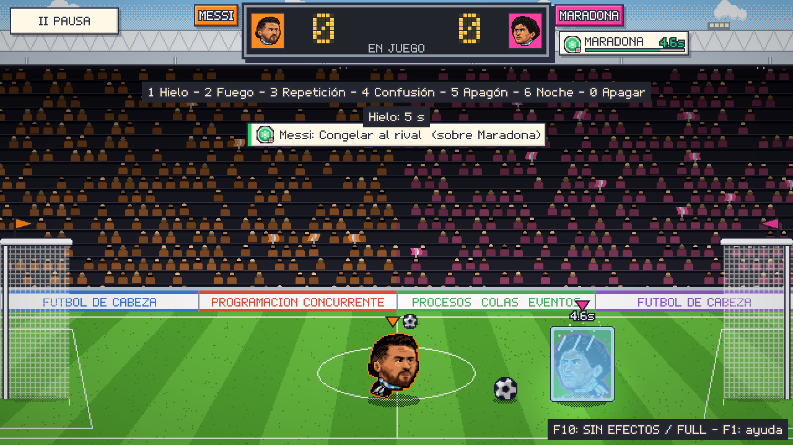
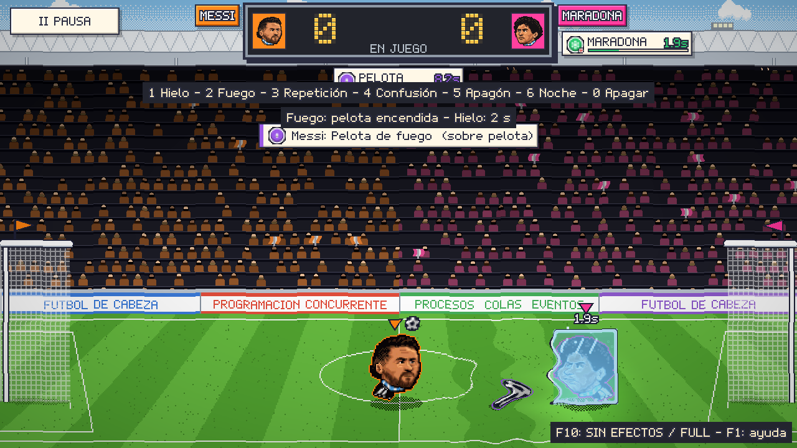
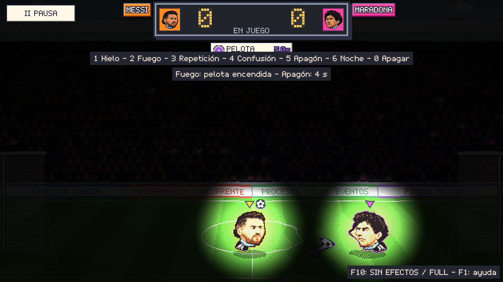
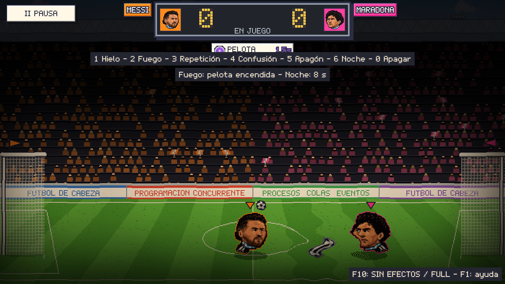

# Fútbol de Cabeza

**Universidad Nacional de La Matanza** · Cátedra de Programación Concurrente (3658) · **Año 2026**

**Trabajo Práctico Integrador: «Fútbol de Cabeza»**

**Número de Grupo:** 5

### Integrantes del Grupo

| DNI | Nombre | E-Mail |
| --- | --- | --- |
| 42562943 | Orellano, Nazareno | nazaorellano@alumno.unlam.edu.ar |
| 43744596 | Saini, Luis | lsaini@alumno.unlam.edu.ar |
| 42375350 | Ruiz, Alejandro | alejaruiz@alumno.unlam.edu.ar |
| 42572105 | Giardelli, Alan Nahuel | agiardelli@alumno.unlam.edu.ar |
| 42592023 | Ojeda, Ernesto | ernojeda@alumno.unlam.edu.ar |
| 42194177 | RodriguezBustos, Mariano | mrodriguezbustos@alumno.unlam.edu.ar |

**Docentes:** Ing. Esteban Carnuccio · Ing. Dario Hirschfeldt · Ing. Máximo Facundo Palomo · Ing. Mariano Leonardo Volker

## 1. Repositorio y enlaces

| Recurso | Enlace |
| --- | --- |
| Repositorio con el código fuente | <https://github.com/UNLAM-PROG-C/2026-PROGC-Q2-M5/tree/develop/TP-Integrador> |
| Página del juego | <https://futbol.timecore.com.ar/> |

El repositorio contiene el código del juego y del servidor, las pruebas automáticas, los benchmarks reproducibles ([`docs/benchmarks/`](docs/benchmarks/)), la documentación de concurrencia y modo online ([`docs/`](docs/)) y los instaladores y scripts de empaquetado ([`tools/`](tools/)).

## 2. Descripción de la solución

**Fútbol de Cabeza** es un juego de fútbol 2D en pixel art: dos cabezones saltan, cabecean y patean, y la pelota activa poderes al tocar los objetos de la cancha. Tiene tres modos de escritorio: **dos personas en el mismo teclado**, **Mundialito contra la computadora** y **1 contra 1 online por salas**. Es el trabajo integrador de Programación Concurrente.

### Finalidad

El juego es el vehículo para aplicar los temas de la materia en un sistema real:

- **Concurrencia con procesos:** la interfaz y la simulación del partido corren en procesos separados que se comunican por colas acotadas, sin memoria compartida.
- **Concurrencia cooperativa:** el servidor online atiende todas las conexiones con un bucle `asyncio` y delega cada sala a su propio proceso de simulación.
- **Paralelismo de datos en GPU:** los efectos visuales se calculan con kernels CUDA (un hilo por píxel o por partícula), con operaciones atómicas donde varios hilos escriben la misma posición. Sin GPU, los mismos efectos se calculan con NumPy.
- **Medición:** benchmarks CPU vs. GPU y de mecanismos de sincronización.

### Lenguaje, frameworks y versiones

| Componente | Uso | Versión |
| --- | --- | --- |
| Python | Lenguaje del juego y del servidor | 3.12 |
| pygame | Ventana, teclado, dibujo y audio | 2.6.1 |
| NumPy | Arreglos e implementación CPU de los filtros | 2.5.4 |
| multiprocessing / threading / asyncio | Procesos, hilos y tareas (biblioteca estándar) | Python 3.12 |
| websockets | Conexión cliente–servidor del modo online (JSON) | 17.1 |
| CUDA C + PyCUDA | Kernels de posprocesado en GPU NVIDIA | PyCUDA 2026.1 |
| PyInstaller | Ejecutables de Windows y Mac | 6.22.3 |
| Docker | Imagen del servidor online | `python:3.12-slim` |

### Arquitectura

- **Concurrencia:** la ventana lee el teclado y dibuja; la simulación mantiene la única cancha oficial y calcula física (paso fijo de 1/120 s), goles y poderes, y publica 60 estados por segundo. En local son dos procesos (contexto `spawn`) conectados por [`SimLink`](fdc/ipc.py): las órdenes llevan confirmación (ACK), los estados llevan número de partido y secuencia, y un `Event` coordina el cierre.
- **Online:** el servidor es la autoridad. Un hilo del cliente recibe de la red; el servidor alterna tareas de conexión y delega cada sala activa a un proceso que usa el mismo [núcleo de simulación](fdc/sim/core.py). El cliente predice su propio movimiento para que se sienta inmediato, pero no decide el resultado.
- **GPU:** los [kernels CUDA](fdc/gpu/kernels.cu) reparten el posprocesado entre hilos. Los histogramas usan `atomicAdd` / `atomicMax` cuando varios hilos suman al mismo bin. Si CUDA no inicializa, el juego pasa a NumPy automáticamente.

### Restricciones de hardware y sistema operativo

| Edición | Sistema operativo | Hardware |
| --- | --- | --- |
| Windows GPU | Windows 10/11 de 64 bits | Placa NVIDIA compatible con driver actualizado (los kernels vienen precompilados), 4 GB de RAM, 300 MB libres |
| Windows CPU | Windows 10/11 de 64 bits | 4 GB de RAM, 300 MB libres. No requiere Python ni CUDA |
| Mac CPU | macOS 14 o posterior | Apple Silicon (M1 o posterior) |
| Desde el código | Windows, macOS o Linux | Python 3.12; CUDA opcional |

**Navegador:** no se necesita para jugar; es una aplicación de escritorio. El servidor online ofrece además, en el mismo puerto (8765), un panel de estado por HTTP que se abre con cualquier navegador actual. El modo online requiere conexión a internet.

### Benchmark CPU vs. GPU

Medianas a 1280 × 720 en una NVIDIA GeForce RTX 5090, 50 corridas por caso después de 5 de calentamiento. El total GPU incluye reservar memoria, subir los datos, ejecutar, bajar el resultado y liberar.

| Operación | CPU NumPy (ms) | Sólo kernel (ms) | GPU total (ms) | Aceleración total |
| --- | ---: | ---: | ---: | ---: |
| Gris | 4,991 | 0,0338 | 0,905 | 5,5× |
| Hielo | 50,217 | 0,0507 | 1,281 | 39,2× |
| Focos | 30,660 | 0,0314 | 1,085 | 28,2× |
| Repetición CRT | 42,112 | 0,0412 | 1,522 | 27,7× |
| Histograma de Noche | 5,988 | 0,1460 | 1,590 | 3,8× |

Son mediciones de operaciones aisladas, no FPS del juego. Acelerar el kernel no elimina las transferencias entre CPU y GPU, por eso importa el tiempo total (ley de Amdahl). En el histograma a 1080p, contar por bloque en memoria compartida redujo el kernel de 0,2869 a 0,0148 ms (19,4×), pero el ciclo completo sólo pasó de 1,053 a 0,766 ms (1,37×).

### Estructura del repositorio

| Ruta | Contenido |
| --- | --- |
| `main.py`, `requirements.txt` | Entrada del juego y dependencias base |
| [`fdc/`](fdc/) | Simulación (`sim/`), interfaz (`ui/`), red (`online/`), comunicación entre procesos (`ipc.py`, `protocol.py`) y efectos CPU/CUDA (`gpu/`) |
| [`assets/`](assets/) | Recursos gráficos y de audio |
| [`deploy/`](deploy/) | Servidor online, Dockerfile y Docker Compose |
| [`docs/`](docs/) | Concurrencia, modo online, guía visual y benchmarks reproducibles |
| [`tests/`](tests/) | Pruebas de simulación, red, interfaz, GPU y estilo |
| [`tools/`](tools/) | Instaladores de Windows, empaquetado de Mac, build de kernels y dependencias |

## 3. Manual de usuario

### Instalación

| Sistema | Qué descargar | Cómo abrirlo |
| --- | --- | --- |
| Windows con NVIDIA | [`FutbolDeCabeza-windows-gpu.zip`](https://github.com/alejandroruiz9/futbol-de-cabeza/releases/latest/download/FutbolDeCabeza-windows-gpu.zip) | Descomprimir el ZIP completo y abrir `FutbolDeCabeza-windows-gpu.exe` |
| Windows sin NVIDIA | [`FutbolDeCabeza-windows-cpu.zip`](https://github.com/alejandroruiz9/futbol-de-cabeza/releases/latest/download/FutbolDeCabeza-windows-cpu.zip) | Descomprimir el ZIP completo y abrir `FutbolDeCabeza-windows-cpu.exe` |
| Mac Apple Silicon | [`FutbolDeCabeza-mac-arm64.zip`](https://github.com/alejandroruiz9/futbol-de-cabeza/releases/latest/download/FutbolDeCabeza-mac-arm64.zip) | Descomprimir el ZIP y abrir `FutbolDeCabeza.app` |

Las descargas están en la sección **Descargas** de la [página del juego](https://futbol.timecore.com.ar/). Linux y Mac Intel no tienen binario: se ejecuta desde el código (ver [al final de esta sección](#ejecutar-desde-el-código-windows-macos-y-linux)).

### Primer inicio y menú principal

Al abrir el juego por primera vez se pide un **nombre** (de 3 a 16 caracteres). Vale para todos los modos y se cambia desde el botón del nombre o con la tecla **N**. El menú se recorre con las flechas o W/S y se elige con Enter o con el mouse.

| Menú principal | Jugar: Mundialito o Multijugador |
| :---: | :---: |
|  |  |

### Elegir modo y personaje

- **Jugar → Multijugador → Local:** dos personas en el mismo teclado.
- **Jugar → Mundialito:** una persona contra la computadora. Son 6 fechas (3 de grupo, cuartos, semifinal y final), cada una contra un rival distinto y más difícil. Sólo se avanza ganando; un empate se define por gol de oro.
- **Jugar → Multijugador → Online:** 1 contra 1 contra otra persona desde su casa.

En la pantalla de selección local, J1 elige con A/D y confirma con Espacio; J2 elige con ←/→ y confirma con P. En la selección online cada persona elige con A/D o las flechas y confirma con Espacio, P o Enter. Los personajes sólo cambian la apariencia, y los dos pueden elegir el mismo.

| Multijugador: Local u Online | Selección de personajes |
| :---: | :---: |
|  |  |

### Controles del partido

| Acción | Jugador 1 | Jugador 2 |
| --- | --- | --- |
| Moverse | A / D | ← / → |
| Saltar | W | ↑ |
| Patear | Espacio | P |
| Pausa | Esc o botón **II PAUSA** | Esc o botón **II PAUSA** |

Un partido dura 60 segundos y el empate vale. La pelota activa poderes al tocar los objetos de la cancha (por ejemplo, congelar al rival, encender la pelota o apagar las luces); la lista completa está en el menú **Poderes**.



*Partido local en curso: marcador, reloj y los dos jugadores.*

### Teclas de función

| Tecla | Qué hace |
| --- | --- |
| F10 | Alterna la calidad entre **SIN EFECTOS** (dibujo base) y **FULL** (posprocesado completo) |
| F4 | En FULL, cambia entre CPU (NumPy) y GPU (CUDA) |
| F2 | Panel de rendimiento: apagado → compacto → completo → pasos de CUDA |
| F3 | Panel de depuración: muestra los PID de la interfaz y de la simulación, colas y ACKs |
| F1 | Ayuda de atajos |
| F11 | Pantalla completa |
| M | Silenciar el sonido |



*Panel F3: dos procesos distintos (PID de la interfaz y de la simulación), órdenes confirmadas y estados recibidos.*

### Modo Presentación y efectos

Desde el menú **Presentación** (o con `--presentation`) se juega sin reloj y se activan los efectos a mano: **1** Hielo, **2** Fuego, **3** Repetición, **4** Confusión, **5** Apagón, **6** Noche y **0** apaga todo. En SIN EFECTOS funcionan 1, 2, 4 y 5; Repetición y Noche requieren FULL.

| 1 · Hielo: el rival queda congelado | 2 · Fuego: la pelota encendida quema al que la toca |
| :---: | :---: |
|  |  |
| **5 · Apagón: focos sobre los jugadores** | **6 · Noche: lámparas y exposición automática** |
|  |  |

### Modo online

- Entrar en **Jugar → Multijugador → Online**. El juego se conecta solo al servidor configurado en las descargas.
- **Crear una sala** (libre o con contraseña) o **unirse** a una de la lista. Cada sala admite 2 personas.
- Cada uno elige personaje y toca **¡LISTO!**. El servidor sortea los lados y empieza el partido. Se puede jugar con cualquiera de las dos combinaciones de teclas.
- **Pausa:** la pide cualquiera y se activa después del próximo gol; el partido sigue cuando los dos tocan «Estoy listo» o a los 30 s.
- **Desconexión:** el partido se pausa y el rival ve una cuenta de 30 s. Si la persona vuelve, se reconecta sola; si no, gana el que se quedó.
- **ABANDONAR** da el partido por perdido. Al terminar se puede pedir **Revancha** o cambiar de personaje.

### Ejecutar desde el código (Windows, macOS y Linux)

Con Python 3.12, desde la carpeta que contiene `main.py`:

```powershell
# Windows (PowerShell)
py -3.12 -m venv .venv
.\.venv\Scripts\python.exe -m pip install -r requirements.txt
.\.venv\Scripts\python.exe main.py --backend cpu
```

```bash
# macOS y Linux
python3 -m venv .venv
.venv/bin/python -m pip install -r requirements.txt
.venv/bin/python main.py --backend cpu
```

- **Online local:** instalar también [`tools/requirements/requirements-online.txt`](tools/requirements/requirements-online.txt), arrancar el servidor con `-m deploy.server` y abrir dos clientes con `--server ws://127.0.0.1:8765/ws` y perfiles distintos.
- **Efectos:** agregar `--calidad full` o presionar F10. Para CUDA hace falta una GPU NVIDIA, su driver y [`tools/requirements/requirements-gpu.txt`](tools/requirements/requirements-gpu.txt); con `--backend auto` usa CUDA si inicializa y NumPy si no.

## 4. Conclusiones

### Separar la física de la interfaz

Cuando separamos la física del dibujo, decidimos usar otro proceso en lugar de sumar un hilo. Con el GIL de CPython 3.12, dos hilos del mismo intérprete no pueden ejecutar bytecode Python al mismo tiempo. Con dos procesos, la física puede avanzar en paralelo con la interfaz. Eso nos obligó a decidir qué podía perderse en el intercambio: para dibujar alcanza con el estado más reciente, pero una orden de pausa necesita una confirmación (ACK). Usamos colas acotadas y dejamos el estado del partido a cargo de la simulación.

El cierre también requirió coordinación. Si esperábamos al hijo sin leer los eventos pendientes, el hijo podía quedar esperando que se liberara espacio para enviarlos. Por eso mandamos una orden de cierre, activamos `stop_event`, drenamos las colas mientras esperamos el aviso de salida y hacemos `join` con tiempo límite. Dejamos la terminación forzada como último recurso.

### Medir y sincronizar en CUDA

Tuvimos que separar el tiempo de cálculo del costo de mover datos. En la RTX 5090, a 1280 × 720, el kernel de Hielo tardó 0,0507 ms, pero el ciclo completo de GPU tardó 1,281 ms, incluidas las transferencias, la reserva y la liberación de memoria. NumPy tardó 50,217 ms. La ventaja se mantuvo, pero medir solo el kernel habría exagerado la mejora que obteníamos en ese ciclo.

También tuvimos que evitar que los hilos pisaran sus incrementos en el histograma de Noche. En la prueba a 1080p con luminancia uniforme, la variante sin atómicas contó 5.941 de 2.073.600 píxeles. Usamos `atomicAdd` para conservar los incrementos y, en el benchmark, probamos un histograma por bloque para reducir la contención. Así, el kernel bajó de 0,2869 a 0,0148 ms, mientras que el ciclo completo pasó de 1,053 a 0,766 ms.

### Latencia online

Medimos una mediana de 302,7 ms de ida y vuelta por el túnel y de 0,45 ms contra el servidor local. La diferencia apuntaba al recorrido de red, no al cálculo de la física. Para que el control respondiera sin esperar ese viaje, hicimos que el cliente predijera el movimiento del jugador propio y lo corrigiera al recibir el estado del servidor. La predicción mejora la respuesta en pantalla; los goles y el resultado siguen definidos por la simulación del servidor.

### Empaquetado y rendimiento en CPU

En Windows, una versión anterior del paquete GPU podía caer a CPU: faltaba una DLL en la ruta de carga y la compilación en el equipo del jugador requería nvcc y MSVC. Incluimos la DLL donde el ejecutable la puede cargar y distribuimos los kernels precompilados. Las pruebas en dos equipos con NVIDIA y en la notebook también nos ayudaron a separar compatibilidad de rendimiento. En CPU, FULL no llegó a 30 FPS en ninguno de los casos medidos. Recomendamos SIN EFECTOS y conservamos el apagón con una superficie reutilizable de Pygame y círculos transparentes, sin el filtro por píxel. En la notebook dio 393,3 y 410,1 FPS sin tope ni ventana visible, frente a 3,6 FPS con el apagón de FULL.

### Aprendizajes

Aprendimos que elegir entre procesos, hilos y tareas asíncronas depende del trabajo que hace cada parte y de qué necesita compartir. Las colas nos obligaron a definir qué mensajes no se pueden perder y en qué orden deben cerrarse los procesos. En GPU, la prueba sin atómicas mostró por qué primero hay que comprobar que el resultado sea correcto y después medir el costo completo, no solo el de la parte que corre en paralelo.

---

## Anexo técnico

Datos del repositorio que complementan las secciones anteriores.

### Dependencias y configuración

Las versiones salen de [`requirements.txt`](requirements.txt), los [requisitos opcionales y de build](tools/requirements/) y la [configuración del servidor](deploy/). El servidor también usa **Docker Compose** (sin versión fijada; se usa `docker compose`) para configurar el servicio, las redes y los chequeos de estado.

### Equipos probados

| Descarga | Sistema probado | Hardware y restricciones |
| --- | --- | --- |
| Windows GPU | Windows 11 Pro (build 26200) y Windows 10 22H2 (build 19045) | No hace falta instalar el CUDA Toolkit para jugar. Pruebas: RTX 5090 con Ryzen 9 9950X3D y 32 GB de RAM; RTX 3080 con Core i7-7700K y 16 GiB de RAM. |
| Windows CPU | Windows 11 Pro y Windows 10 22H2 en las pruebas de rendimiento en CPU | Los dos equipos de la fila anterior son referencias de rendimiento, no requisitos mínimos. |
| Mac CPU | macOS 26.6.1 en Apple Silicon (`arm64`) | Probado en un Apple M3 Max. El paquete no usa CUDA y no es para Mac Intel. |

El [`fatbin`](fdc/gpu/kernels.fatbin) trae código para `sm_75`, `sm_80`, `sm_86`, `sm_89`, `sm_90`, `sm_100` y `sm_120`; el [build](tools/build_kernels.py) también incorpora PTX para `compute_120`. `sm_75` (Turing) es la arquitectura más antigua incluida, no una GPU mínima probada.

En el [benchmark de FPS](docs/benchmarks/bench_fps/RESULTADOS.md), a 1280 × 720 y sin tope de cuadros ni ventana visible, **SIN EFECTOS** dio 1739,5 FPS en el Ryzen 9 9950X3D, 789,5 en el Core i7-7700K y 669,7 en la notebook de referencia (Core i7-8565U, 16 GB de RAM, Ubuntu 26.04). Son cifras del banco de pruebas, no FPS en pantalla. En CPU con **FULL**, los tres equipos quedaron por debajo de 30 FPS en todos los casos medidos.

### Servidor online

El servidor público corre en Docker en un NAS con Linux. El cliente de escritorio se comunica por WebSocket sobre TCP, con mensajes JSON. El servidor comprueba la versión del protocolo al conectar: `PROTOCOL_VERSION = 2`. Los detalles están en [Modo online](docs/ONLINE.md) y en la [configuración de Docker](deploy/README.md).

### Esquema de procesos

```text
LOCAL
[Ventana Pygame] ── órdenes + controles ──► [Proceso de simulación]
                 ◄─ estados + eventos ──────
                 Cuatro colas acotadas + señal de cierre

ONLINE
[Clientes] ◄─ WebSocket/JSON ─► [Servidor asyncio] ◄─ colas ─► [Proceso por sala]

IMAGEN (en cada cliente, local u online)
[Cuadro Pygame] → [Filtros CUDA o NumPy, si FULL] → [Marcador + pantalla]
```

Sin CUDA, FULL calcula los filtros con NumPy; SIN EFECTOS conserva el juego, los poderes y el marcador sin posprocesado.

### Detalles del benchmark

La aceleración total es tiempo NumPy dividido por tiempo GPU total. Por ejemplo, hielo a 1080p pasó de 120,193 a 1,940 ms (61,9× en el ciclo completo). En Noche la medición GPU termina al descargar los conteos y el máximo; no incluye el resumen que sí calcula la referencia CPU. La comparación con locks en CPU y la prueba de conteo sin atómicas están en [los resultados de sincronización](docs/benchmarks/bench_sync/RESULTADOS.md). Consultá también [los FPS por efecto](docs/benchmarks/bench_fps/RESULTADOS.md).

### Detalles del modo Presentación

`1` congela a J2 y `2` enciende la pelota, que quema al primero que la toque. `0` apaga los efectos manuales; el hielo y el fuego vencen solos. Presentación no cambia la calidad (eso lo hace `F10`), y en SIN EFECTOS la leyenda no muestra Repetición ni Noche.

### Otros archivos de la raíz

| Ruta | Contenido |
| --- | --- |
| [`docs/guia-visual.md`](docs/guia-visual.md) | Diseño visual del juego |
| [`deploy/README.md`](deploy/README.md) | Lanzador del servidor, Dockerfile y Compose |
| [`docs/manual/`](docs/manual/) | Capturas de este manual |
| `.dockerignore`, `.gitattributes`, `.gitignore` | Contexto de imagen, finales de línea y exclusiones locales |
